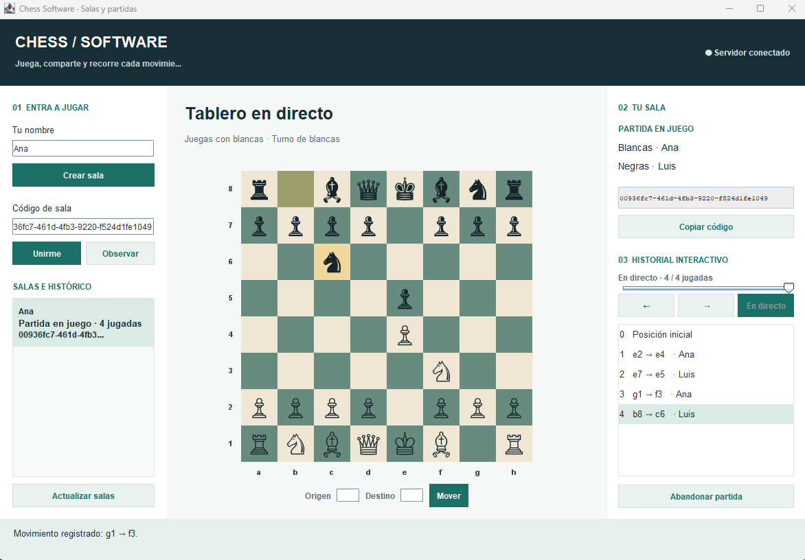
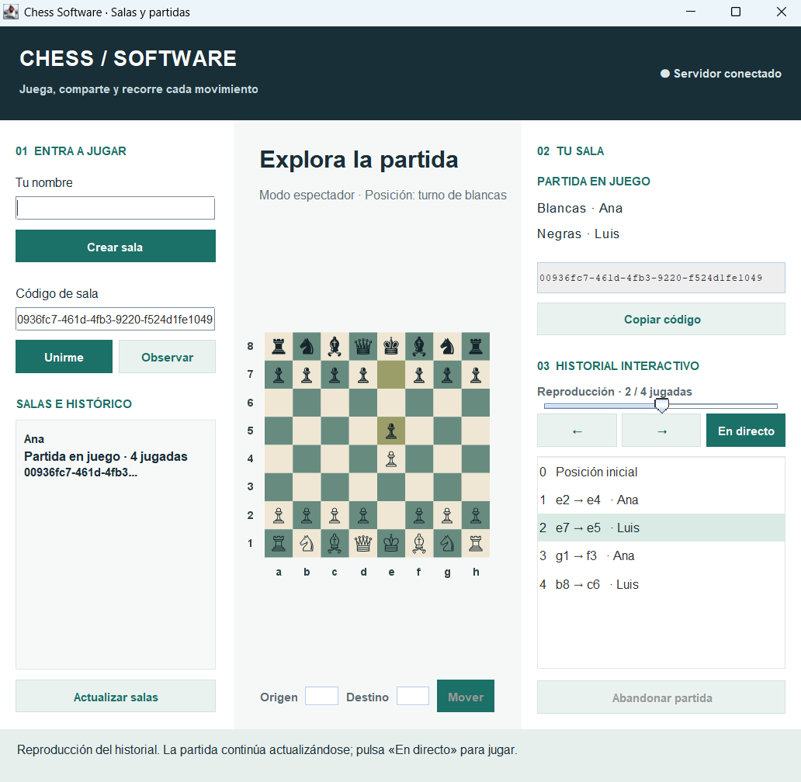
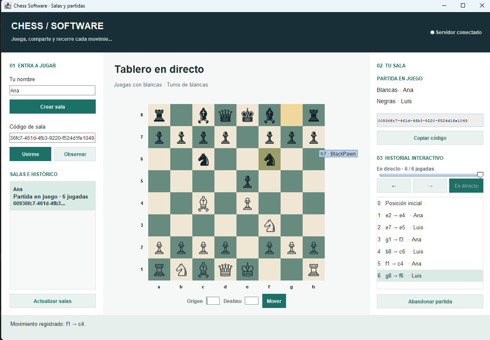

# Verificación manual del sistema integrado

Estado del registro: COMPLETADO.

## Entorno y versión probada

- Fecha del recorrido: 14 de noviembre de 2026.
- Sistema operativo: Windows 11.
- JDK utilizado: Java 27; compilación configurada con release 27.
- Commit del código probado: `bdba63cfdc170497e493bfd020059eea9f529236`.
- Rama: `feature/12-manual-verification`.
- Copia limpia: `chess-software-session12-check`, en una carpeta hermana del proyecto principal.
- Servidor utilizado: `http://127.0.0.1:8081`.
- Almacenamiento: `data/session-12` dentro de la copia limpia.
- Sala: `00936fc7-461d-4fb3-9220-f524d1fe1049`.
- Jugadores: Ana con blancas y Luis con negras; un tercer cliente actuó como observador.
- Resultado de la suite en el proyecto original y en el clon: **85 pruebas, 0 fallos, 0 errores y 0 omitidas**.

La versión se compiló desde el clon de la rama publicada. El comando Maven equivalente y portable es:

```text
mvn clean verify -Djava.awt.headless=true
```

El modo headless corresponde a las pruebas. Para el recorrido se abrieron las ventanas de escritorio con
`FrontendMain`, cada una en un proceso independiente del backend.

## Arranque utilizado

Desde la raíz de la copia limpia, el backend se ejecutó con:

```text
java -jar target/chess-software-1.0.0.jar --host 127.0.0.1 --port 8081 --data data/session-12
```

Cada uno de los tres clientes se ejecutó con:

```text
java -cp target/chess-software-1.0.0.jar software.ulpgc.chess.frontend.FrontendMain --server http://127.0.0.1:8081
```

En el reinicio se mantuvieron el puerto y el directorio de datos. Las tres ventanas permanecieron abiertas,
conservando sus credenciales locales. El registro reúne el recorrido realizado, sus capturas y las comprobaciones
del estado persistido. Los rechazos, la cancelación y el cierre se comprobaron durante la ejecución; no tienen
una captura individual adjunta.

## Resultados

Cada entrada del historial representa una media jugada: el movimiento de un solo jugador.

| Caso | Comprobación | Resultado observado |
|---|---|---|
| M01 | Compilar y probar una copia limpia de la rama publicada. | CORRECTO. El proyecto original y el clon superaron las 85 pruebas con Java 27. El clon utilizó el commit indicado. |
| M02 | Ejecutar backend y tres clientes independientes. | CORRECTO. Las ventanas accedieron al servidor por el puerto 8081. La incidencia inicial del puerto 8080 se resolvió como se describe abajo. |
| M03 | Crear sala con Ana y unirse con Luis. | CORRECTO. Ambos jugadores aparecieron en la misma sala activa. La ventana de negras mostró su orientación correspondiente. |
| M04 | Consultar la sala desde un observador. | CORRECTO. El tercer cliente mostró Modo espectador, permitió consultar el historial y mantuvo deshabilitados Mover y Abandonar. |
| M05 | Realizar las cuatro primeras medias jugadas. | CORRECTO. Se registraron e2-e4, e7-e5, g1-f3 y b8-c6. La vista en directo mostró cuatro entradas y turno de blancas. |
| M06 | Intentar f3-f5 con Ana. | CORRECTO. La jugada inválida se rechazó, el caballo permaneció en f3 y no se añadió ninguna entrada. |
| M07 | Intentar g8-f6 con Luis cuando tocaba blancas. | CORRECTO. El backend rechazó la orden por turno incorrecto y el historial conservó cuatro entradas. |
| M08 | Reproducir la posición 2/4 desde el observador. | CORRECTO. Se mostraron los peones en e4/e5 y los caballos en g1/b8, manteniendo las cuatro entradas del historial. En directo recuperó la posición actual. |
| M09 | Abrir Abandonar y cancelar. | CORRECTO. Al cancelar el diálogo, la partida continuó activa y conservó sus cuatro entradas. |
| M10 | Detener sólo el backend. | CORRECTO. Los clientes comunicaron el fallo de conexión y conservaron la sala y la última vista cargada. |
| M11 | Reiniciar el backend con el mismo puerto y almacenamiento. | CORRECTO. Tras actualizar las consultas se recuperaron la misma sala, los jugadores y las cuatro medias jugadas. Los clientes mantuvieron sus sesiones locales. |
| M12 | Continuar jugando después del reinicio. | CORRECTO. Ana jugó f1-c4 y Luis g8-f6. El historial pasó a seis entradas y las ventanas mostraron la nueva posición. |
| M13 | Abandonar con Ana y confirmar. | CORRECTO. La partida terminó con victoria de negras y conservó las seis entradas. El estado guardado es BLACK_WON, versión 8. |
| M14 | Cerrar las aplicaciones del ensayo. | CORRECTO. Se cerraron las ventanas de clientes y se detuvo el backend. |

## Capturas del recorrido

Son capturas de las ventanas reales de esta ejecución. Las tres pertenecen a la misma sala y se conservan
separadas de los renderizados automatizados de la sesión 11.

### Partida en directo

Ana y Luis conectados, cuatro medias jugadas registradas y turno de blancas:



### Reproducción del histórico

El observador muestra la posición 2/4 mientras la sala conserva sus cuatro entradas:



### Continuación después del reinicio

La partida continúa con seis medias jugadas después de recuperar la conexión con el backend:



## Estado persistido al terminar

La sala guardada conserva los siguientes datos:

- Identificador: `00936fc7-461d-4fb3-9220-f524d1fe1049`.
- Blancas: Ana.
- Negras: Luis.
- Estado final: `BLACK_WON`.
- Versión final: `8`.
- Historial: seis medias jugadas, en este orden:

```text
1. Ana:  e2-e4
2. Luis: e7-e5
3. Ana:  g1-f3
4. Luis: b8-c6
5. Ana:  f1-c4
6. Luis: g8-f6
```

El abandono cambia el resultado y la versión, pero no añade una jugada al historial.
El archivo de sala permanece en el directorio de datos del ensayo, excluido de Git. No se publican tokens ni hashes.

## Incidencia resuelta

El primer arranque en el puerto 8080 devolvió `BindException: Address already in use`.
Se comprobó que Docker/WSL utilizaban ese puerto y se configuró el ensayo en el 8081, tanto para el servidor
como para los tres clientes. Al reiniciar se conservó esa configuración y el mismo directorio de datos.

## Límites de la comprobación

- Se reinició el backend manteniendo abiertos los clientes. Esto comprueba recuperación de la partida desde
  archivos y continuación con las sesiones conservadas; no recupera la identidad de un cliente cerrado.
- El backend valida legalidad y turno. El bloqueo visual de movimientos fuera de turno queda para la sesión 13.
- Tras recuperar la conexión se utilizó Actualizar salas; un aviso anterior puede mantenerse hasta una acción correcta.
- Cancelar el diálogo de abandono comprueba su efecto visible, no constituye una medición del tráfico de red.
- No se implementan enroque, captura al paso ni adjudicación automática de mate, ahogado o tablas.
- La persistencia requiere una única instancia escritora por directorio. No se ensayan varios servidores escribiendo a la vez.

## Conclusión

Resultado global: SATISFACTORIO PARA EL ALCANCE IMPLEMENTADO.

El recorrido verificó el funcionamiento desde una copia limpia, la comunicación entre procesos, las acciones
de jugadores y observador, los errores previstos, la reproducción del historial, la recuperación del backend
y la conservación del resultado y de los movimientos. La incidencia de arranque quedó resuelta utilizando el
puerto 8081. No quedaron incidencias materiales abiertas en este recorrido; se conservan los límites descritos.
